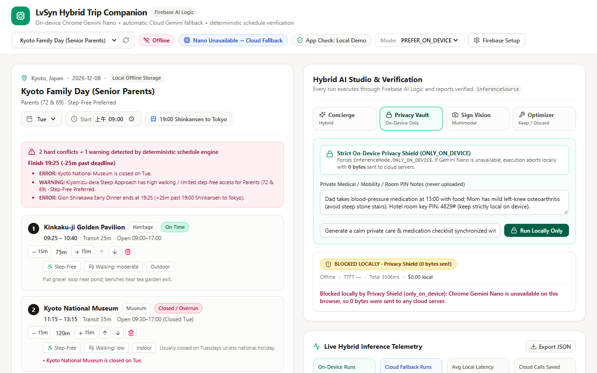
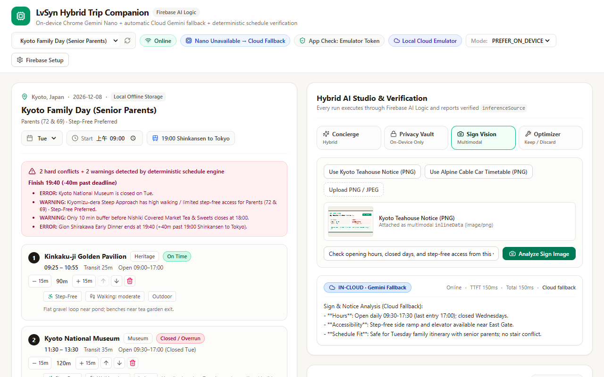
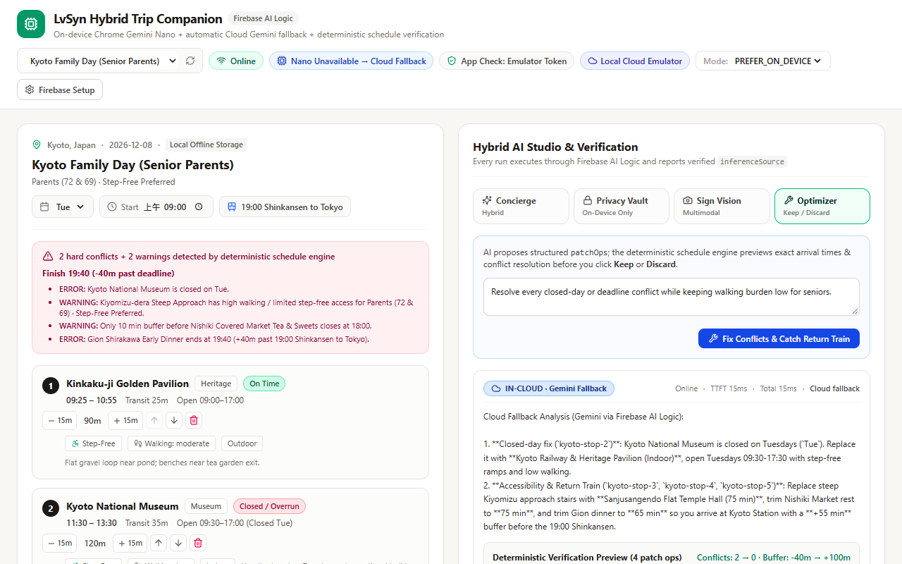
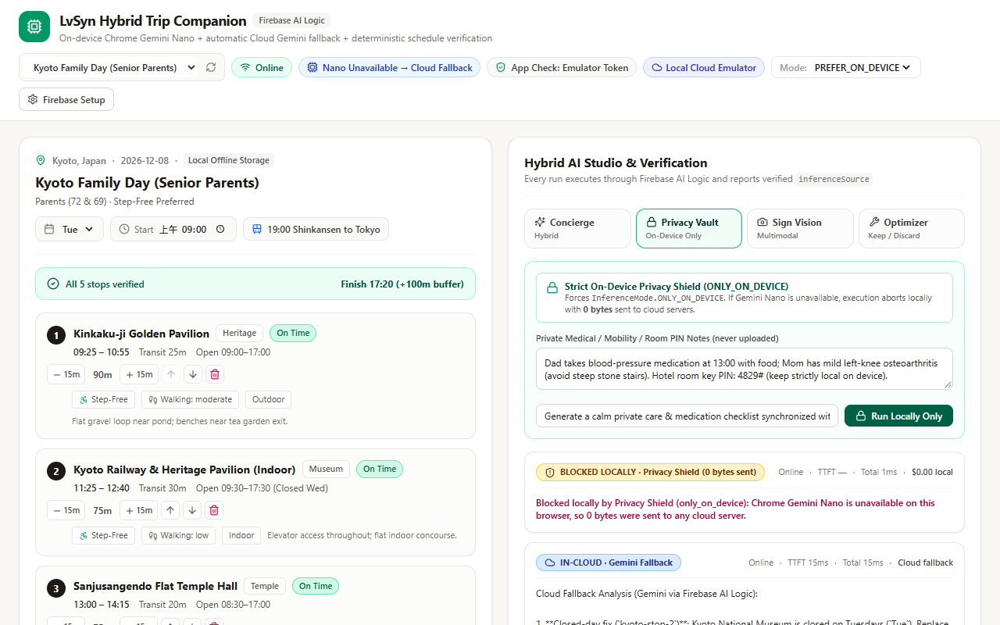

# LvSyn Hybrid Trip Companion

> **Built for Google Firebase `#BuildHybridAI` 2026 (Web / Chrome PWA)**  
> An offline-capable, on-device + cloud hybrid AI trip editing companion powered by **Firebase AI Logic** (`firebase/ai`), **Chrome Gemini Nano**, **Firebase App Check**, **Remote Config**, **Offline Firestore Cache**, and a **deterministic schedule verification engine**.

---

## Why Hybrid AI Matters for Real Travelers

Travelers planning and adjusting multi-stop itineraries—especially families traveling with senior parents or commuters passing through rail tunnels—hit two failure modes:

1. **Connectivity Dead-Zones:** Mountain railways, subways, and roaming gaps break pure cloud AI chatbots right when travelers need accessibility notes, timing adjustments, or sign/menu interpretation.
2. **Unverified LLM Hallucinations & Privacy Leaks:** Pure generative models frequently overlook Tuesday museum closures, steep stairways, or return-train cutoffs—and uploading private medical reminders or hotel door codes to remote clouds creates avoidable privacy risk.

**LvSyn Hybrid Trip Companion** solves both by separating **semantic reasoning** (handled by Firebase AI Logic Hybrid Inference) from **deterministic schedule verification** (handled locally in TypeScript) and pairing them with an explicit **Keep / Discard** confirmation loop.

---

## Architecture

```mermaid
flowchart LR
    U[Traveler Action] --> Policy{Task Policy & Mode}
    Policy -->|Concierge / Sign Vision / Optimizer<br/>PREFER_ON_DEVICE| SDK[Firebase AI Logic SDK<br/>firebase/ai getGenerativeModel]
    Policy -->|Privacy Vault<br/>ONLY_ON_DEVICE| Guard[Pre-Flight Privacy Shield Guard]
    Guard -->|Nano Available| SDK
    Guard -->|Nano Unavailable| Shield[Blocked Locally<br/>0 Bytes Uploaded]
    SDK --> Chrome{ChromeAdapter<br/>LanguageModel.availability}
    Chrome -->|Available| Nano[Chrome Gemini Nano<br/>On-Device · 0 Cloud Calls · $0]
    Chrome -->|Unavailable| Cloud[Cloud Gemini Fallback<br/>gemini-3.5-flash-lite + App Check]
    Nano --> Telemetry[Live inferenceSource Telemetry]
    Cloud --> Telemetry
    Nano --> Parser[patchOps Extractor]
    Cloud --> Parser
    Parser --> Engine[Deterministic Schedule Engine]
    Engine --> Diff[Before/After Verification Diff]
    Diff --> Keep{Traveler Decision}
    Keep -->|Keep| Timeline[(Trip Timeline + Firestore Offline Cache)]
    Keep -->|Discard| NoOp[Original Itinerary Preserved]
```



### Verified Firebase SDK Entry Points

- **Firebase AI Logic Hybrid Inference:** [`src/ai/hybridInferenceService.ts`](src/ai/hybridInferenceService.ts) imports `getGenerativeModel`, `InferenceMode`, and `InferenceSource` from `firebase/ai`, invokes `model.initializeDeviceModel(...)`, streams via `model.generateContentStream(...)`, and reads `finalResponse.inferenceSource` (`"on_device"` vs `"in_cloud"`).
- **Pre-Flight `ONLY_ON_DEVICE` Privacy Shield Guard:** During SDK contract testing against `@firebase/ai@3.1.0`, we observed that when `globalThis.LanguageModel` is absent, `chromeAdapterFactory` returns `undefined`, causing `callHybrid` in the SDK to bypass `InferenceMode.ONLY_ON_DEVICE` and invoke `inCloudCall()`. [`src/ai/hybridInferenceService.ts`](src/ai/hybridInferenceService.ts) closes this gap by verifying local `LanguageModel.availability` (with a 3.5s IPC timeout guard) before invoking `generateContentStream()` under `ONLY_ON_DEVICE`, guaranteeing **0 bytes** leave the device when local weights are unavailable.
- **Firebase App Check, Remote Config & Offline Firestore:** [`src/firebase/init.ts`](src/firebase/init.ts) initializes `initializeAppCheck` (supporting reCAPTCHA v3, Firebase Console debug tokens via `FIREBASE_APPCHECK_DEBUG_TOKEN`, or a local dev custom provider), `getAI(app, { backend: new GoogleAIBackend() })`, `getRemoteConfig`, and `initializeFirestore` with `persistentLocalCache`.
- **Deterministic Schedule Engine:** [`src/domain/scheduleEngine.ts`](src/domain/scheduleEngine.ts) computes exact stop arrival/departure minutes, waiting times, closed-day violations, return-train margins, and accessibility mismatches, verifying every AI-proposed `patchOps` preview before **Keep / Discard**.

---

## Verified Real-Browser Screenshots

All four screenshots below were captured directly from the built production bundle (`dist/`) running in isolated headless Google Chrome (`scripts/verify-e2e-and-capture.mjs`) against the local Firebase AI Logic SSE emulator (`scripts/local-cloud-emulator.mjs`):

| Offline PWA Edit & Privacy Shield (`ONLY_ON_DEVICE` -> 0 bytes sent) | Multimodal Sign Vision Cloud Fallback (`IN-CLOUD` + App Check) |
|---|---|
|  |  |

| Schedule Optimizer Cloud Fallback & Conflict Diff (`2 -> 0` conflicts) | Keep Applied (`All 5 stops verified`) & Online Privacy Shield |
|---|---|
|  |  |

---

## Verification Summary (Observed Results)

- **Type-check & Build (`npm run build`):** `tsc --noEmit` (0 errors) and Vite production bundle built cleanly to `dist/`.
- **Unit & Browser-ESM SDK Contract Tests (`npm test`):** `6/6` tests passing across `tests/scheduleEngine.test.ts` (2 tests) and `tests/hybridInference.test.ts` (4 tests against `@firebase/ai@3.1.0` browser ESM `ChromeAdapterImpl` + local HTTP SSE emulator, verifying `on_device` routing with 0 cloud calls, `in_cloud` fallback with `X-Firebase-AppCheck` and `x-goog-api-client: ... hybrid`, `ONLY_ON_DEVICE` leak prevention, and multimodal PNG `inlineData`).
- **Chrome E2E Verification (`npm run e2e:verify`):**
  - Probed isolated headless Chrome 158 with Prompt API flags (`LanguageModel.availability()` returned `timeout_6000ms` because on-device Gemini Nano weights are not pre-downloaded on the build machine).
  - Verified true `Offline` PWA interaction + deterministic timeline recalculation + `ONLY_ON_DEVICE` local block with **0** outbound requests.
  - Verified online automatic fallback (`PREFER_ON_DEVICE` -> `IN_CLOUD` via local dev SSE emulator) with `X-Firebase-AppCheck` header, multimodal PNG `inlineData` sign analysis, deterministic Schedule Optimizer `Keep` repair (`Conflicts: 2 -> 0`, `+100m buffer`), and `ONLY_ON_DEVICE` cloud-leak prevention.
- **Secret & Git History Scan (`npm run scan:secrets`):** 0 secret, key, personal email, local path, or proprietary backend findings across working tree and commit history.

---

## Pre-Existing App Disclosure (`LvSyn NEXT`)

- **Existing Foundation:** Prior to the `#BuildHybridAI` 2026 submission period, our team created **LvSyn NEXT**, an integrated trip editing environment (its web version is live, and the Android app has received Google Play production release approval and is currently in closed testing).
- **Core Value Reused Conceptually:** The deterministic time-anchoring verification model and **Keep / Discard** co-editing pattern keep hybrid AI proposals grounded in real opening hours, transfer minutes, and return deadlines.
- **Built During #BuildHybridAI 2026 (After Nov 11, 2026):** This repository is a clean, standalone, Apache-2.0 open-source Web/Chrome PWA written from scratch with zero proprietary backend secrets, introducing:
  1. `firebase/ai` (`@firebase/ai@3.1.0`) hybrid inference (`PREFER_ON_DEVICE`, `ONLY_ON_DEVICE`, `PREFER_IN_CLOUD`, `ONLY_IN_CLOUD`), `initializeDeviceModel` download flow, and live `inferenceSource` telemetry.
  2. **Strict On-Device Privacy Vault** (`ONLY_ON_DEVICE`) with a pre-flight local-only guard against `@firebase/ai@3.1.0` cloud fallback when `LanguageModel` is absent.
  3. **Multimodal Sign & Notice Vision** passing PNG/JPEG `inlineData` through `ChromeAdapterImpl`.
  4. **Firebase App Check**, **Remote Config**, **Offline Firestore persistence**, and a **Service Worker offline PWA shell**.

---

## Quickstart & Testing Instructions

### Prerequisites
- Node.js `>= 20` and npm
- Google Chrome Desktop `>= 139` (tested on Chrome `158`)

### 1. Install Dependencies
```bash
npm install
```

### 2. Run Locally (Zero-Billing Local Cloud Emulator + Vite Dev Server)
For fast local testing without any cloud credentials or billing:
```bash
# Terminal 1: Start the local Firebase AI Logic SSE cloud fallback emulator (port 8788)
npm run dev:emulator

# Terminal 2: Start the Vite app pointing to the local emulator
VITE_AI_EMULATOR_URL=http://127.0.0.1:8788 npm run dev
```
You can also paste any Spark-plan Firebase Web Config or emulator URL directly in the UI via **Firebase Setup** without rebuilding.

### 3. Enable Chrome On-Device Gemini Nano (For Live Hardware On-Device Inference)
1. Open `chrome://flags/#prompt-api-for-gemini-nano-multimodal-input` and set it to **Enabled**, then relaunch Chrome.
2. Open the app in Chrome and click **Prepare Nano** (calls `model.initializeDeviceModel()`), or verify in DevTools Console:
   ```js
   await LanguageModel.availability();
   ```
3. Once **Gemini Nano Ready** appears, open **Chrome DevTools → Network → Offline** and run **Concierge**, **Privacy Vault**, or **Sign Vision** with 0 outbound network calls.

### 4. Connect a Free Spark-Plan Firebase Project (Zero Billing)
1. Copy `.env.example` to `.env.local` (`.env.local` is gitignored).
2. In the [Firebase Console](https://console.firebase.google.com/), create a **Spark plan (no-cost)** project (no billing account required for Gemini Developer API free tier).
3. Go to **AI Services → AI Logic → Get started**, select **Gemini Developer API**, and enable **App Check**.
4. For localhost testing, set `VITE_APPCHECK_DEBUG_TOKEN=true`, start the app, copy the printed `AppCheck debug token` from DevTools Console, and register it under **App Check → Apps → Manage debug tokens**.

### 5. Run Verification Suites
```bash
# TypeScript type-check & production Vite bundle
npm run build

# Unit & real firebase/ai browser-ESM SDK contract tests
npm test

# Secret & full git history hygiene scan
npm run scan:secrets

# Automated Chrome E2E verification + screenshot capture
npm run e2e:verify
```

---

## License

Licensed under the **Apache License, Version 2.0**. See [`LICENSE`](LICENSE).
