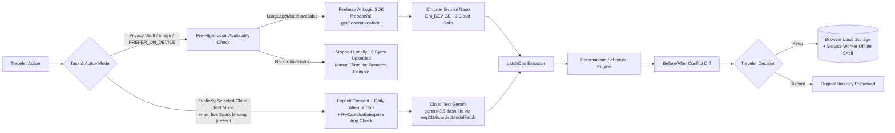
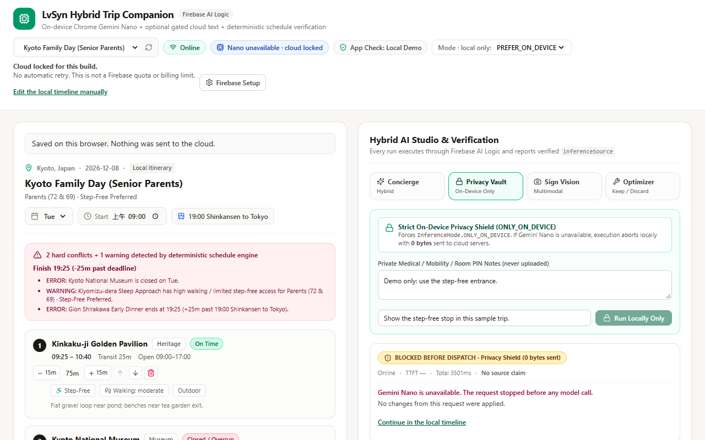
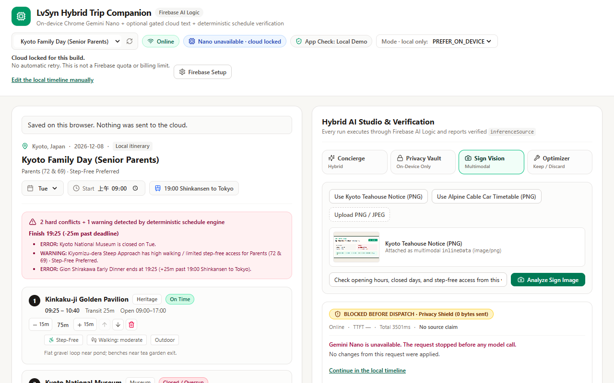
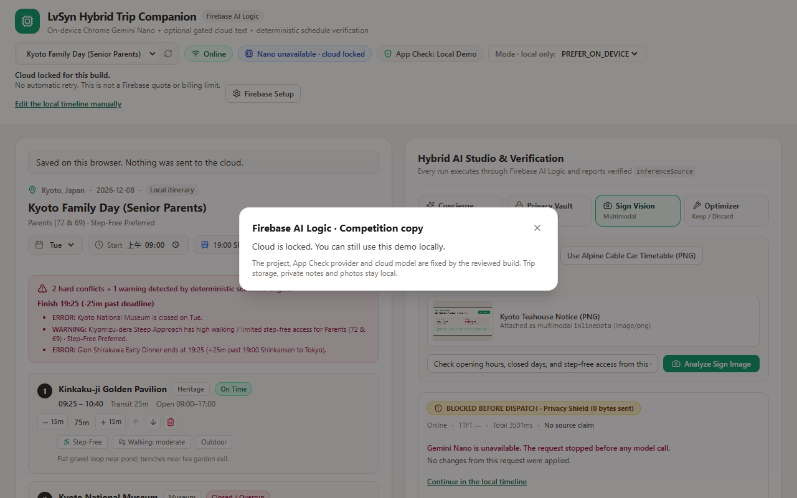

# LvSyn Hybrid Trip Companion

> **Built for Google Firebase `#BuildHybridAI` 2026 (Web / Chrome PWA)**  
> An offline-capable, on-device-first hybrid AI trip editing companion powered by **Firebase AI Logic** (`firebase/ai`), **Chrome Gemini Nano**, **Firebase App Check**, and a **deterministic schedule verification engine**.

- **Hosted Live Try-It-Out (Static Web/Chrome PWA):** https://qaqaaa233.github.io/lvsyn-hybrid-trip-companion/
- **License:** Apache License, Version 2.0 (`LICENSE`)

---

## Why Hybrid AI Matters for Real Travelers

Travelers adjusting multi-stop itineraries—such as families visiting cities with senior parents or commuters riding through mountain rail tunnels—encounter two failure modes:

1. **Connectivity Dead-Zones & Sensitive Notes:** Subway tunnels and roaming gaps break cloud-only chat assistants right when travelers need timing adjustments, while private medical reminders, mobility notes, or accommodation door codes should never be silently uploaded to remote servers.
2. **Unverified AI Schedule Suggestions:** Free-form model outputs can ignore Tuesday venue closures, steep walking burdens, or return-train deadlines unless every proposed edit is checked against deterministic constraints before saving.

**LvSyn Hybrid Trip Companion** separates **semantic inference** (routed through Firebase AI Logic `firebase/ai`) from **deterministic schedule verification** (computed locally in TypeScript) and keeps itinerary changes manual and reversible via explicit **Keep / Discard** confirmation scoped to the active trip.

---

## Architecture & Routing Policy



### Firebase AI Logic & Safety Entry Points

- **Hybrid Inference Service (`src/ai/hybridInferenceService.ts`):** Uses `getGenerativeModel`, `InferenceMode`, and `InferenceSource` from `firebase/ai` (`@firebase/ai@3.1.0`), calls `model.initializeDeviceModel(...)` and `model.generateContentStream(...)`, and accepts output only when `finalResponse.inferenceSource` and terminal text verify (`sdk_terminal_response`). Includes a pre-flight `ONLY_ON_DEVICE` availability check (with a 3.5s IPC timeout guard) so missing `globalThis.LanguageModel` never triggers an unexpected cloud fallback, and does not silently escalate `PREFER_ON_DEVICE` failures to the cloud.
- **App Check & Spark Egress Controls (`src/firebase/config.ts`, `src/firebase/init.ts`, `src/firebase/req211Egress.ts`, `src/firebase/cloudAttemptBudget.ts`):** Cloud text mode stays locked in unbound open-source builds (`Mode · local only`). When built with a verified Spark-plan project binding and enforced `ReCaptchaEnterpriseProvider` App Check, explicit cloud requests verify the App Check token claims, enforce text-only egress on `gemini-3.5-flash-lite`, and cap daily browser attempts (`DAILY_CLOUD_ATTEMPT_LIMIT = 3` per UTC day) with no automatic retry loop.
- **Deterministic Schedule Engine (`src/domain/scheduleEngine.ts` & `src/domain/proposal.ts`):** Computes exact arrival/departure times, waiting windows, closed-day violations, walking/step-free warnings, and return-train buffers offline, and scopes proposals to the active `tripId`.

---

## Verified Build Screenshots (Unbound Local Build)

The four screenshots below were captured directly from the built production bundle (`dist/`) running in isolated headless Google Chrome (`chrome` channel) with zero external network requests (`externalRequests: 0`, `consoleErrors: 0`):

| Offline PWA Timeline Edit (`90m -> 75m` saved offline) | Privacy Vault Local Block (`ONLY_ON_DEVICE`, `0 bytes sent`) |
|---|---|
|  |  |

| Sign Vision Explicit Non-Escalation Gate | Firebase Competition Setup Status |
|---|---|
|  |  |

---

## Verification Summary (Observed Facts)

- **Type-check (`tsc --noEmit`):** 0 TypeScript errors.
- **Unit & Browser-ESM SDK Contract Tests (`npm test`):** `6/6` tests passing across `tests/scheduleEngine.test.ts` (2 tests) and `tests/hybridInference.test.ts` (4 tests against `@firebase/ai@3.1.0` + local HTTP SSE emulator covering `ON_DEVICE` routing, `ONLY_ON_DEVICE` leak prevention, multimodal PNG `inlineData`, and `X-Firebase-AppCheck` / `x-goog-api-client` headers).
- **Chrome Bundle Verification:** Tested the built production bundle in isolated headless Chrome:
  - Edited Kinkaku-ji duration (`90m -> 75m`), switched context offline, reloaded cleanly, and verified local persistence (`Local itinerary` / browser storage).
  - Ran **Privacy Vault** with harmless demo notes (`Demo only: use the step-free entrance.`) and verified `BLOCKED BEFORE DISPATCH · Privacy Shield (0 bytes sent)` with 0 outbound cloud calls when Chrome Gemini Nano weights are not loaded.
  - Verified **Sign Vision** PNG attachment + explicit non-escalation behavior and active-trip scoping when switching preset itineraries.
- **Secret & Git History Hygiene (`npm run scan:secrets`):** 0 secrets, API keys, personal emails, local user paths, or restricted markers across working tree and commit history.
- **Scope Note:** The public open-source build ships unbound (no bundled API keys or live Spark project credentials). Live Chrome Gemini Nano inference requires Chrome Built-in AI model weights to be enabled and downloaded on the reviewer's device; live cloud text fallback requires building with your own Spark-plan Firebase Web App and enforced App Check binding.

---

## Pre-Existing App Disclosure (`LvSyn NEXT`)

- **Pre-Existing Work:** Before the `#BuildHybridAI` 2026 contest period, our team created **LvSyn NEXT**, an integrated travel planning environment whose core time-anchoring verification model and **Keep / Discard** itinerary co-editing concept inspired this entry.
- **Developed During `#BuildHybridAI` 2026 (Standalone Repository):** This repository is an independent, clean-room Apache-2.0 Web/Chrome PWA built specifically for the hackathon, adding the `firebase/ai` Hybrid Inference integration, the `ONLY_ON_DEVICE` pre-flight Privacy Shield guard, multimodal PNG `inlineData` sign analysis, Firebase App Check & egress verification, Service Worker offline shell, and trip-scoped proposal review.

---

## Quickstart & Testing Instructions

### Online Try-It-Out (Zero Credentials Required)
Open **https://qaqaaa233.github.io/lvsyn-hybrid-trip-companion/** in Google Chrome Desktop (`>= 139`):
1. In **Kyoto Family Day (Senior Parents)**, click **- 15m** on **Kinkaku-ji Golden Pavilion** (`90m -> 75m`) and watch the deterministic arrival/departure times and deadline buffer recalculate immediately.
2. Open **Chrome DevTools → Network → Offline**, reload the page, and confirm the offline Service Worker shell loads with your shortened visit intact in local browser storage.
3. Open **Privacy Vault**, enter any harmless test note (for example, `Demo only: use the step-free entrance.`), and click **Run Locally Only**. When on-device Gemini Nano weights are absent, the request aborts locally with **0 bytes** uploaded.
4. Open **Sign Vision**, pick **Use Kyoto Teahouse Notice (PNG)**, and click **Analyze Sign Image** to verify multimodal attachment without silent cloud escalation.
5. *(Optional, for On-Device Hardware Model Testing)* Enable `chrome://flags/#prompt-api-for-gemini-nano-multimodal-input` in Chrome, relaunch, click **Prepare Nano** when shown, and run **Concierge** or **Privacy Vault** offline on-device.

### Local Build & Tests
- **Prerequisites:** Node.js `>= 20` and npm.

```bash
npm install
npm run build
npm test
npm run scan:secrets
```

To test the local Firebase AI Logic SSE emulator in Vitest or development, inspect `scripts/local-cloud-emulator.mjs` and `.env.example` (no `.env.local` or live keys are ever committed).

---

## License

Licensed under the **Apache License, Version 2.0**. See [`LICENSE`](LICENSE).
