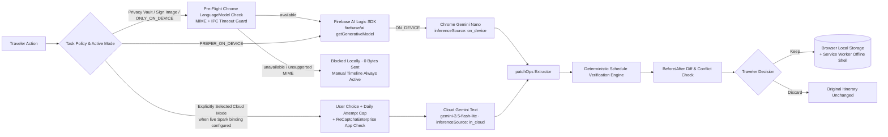
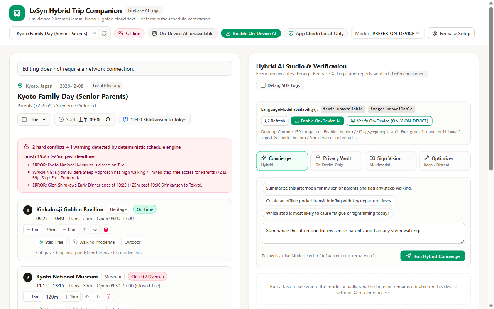
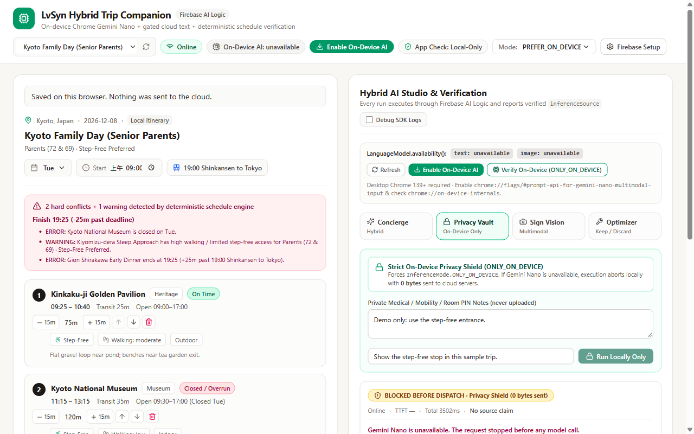
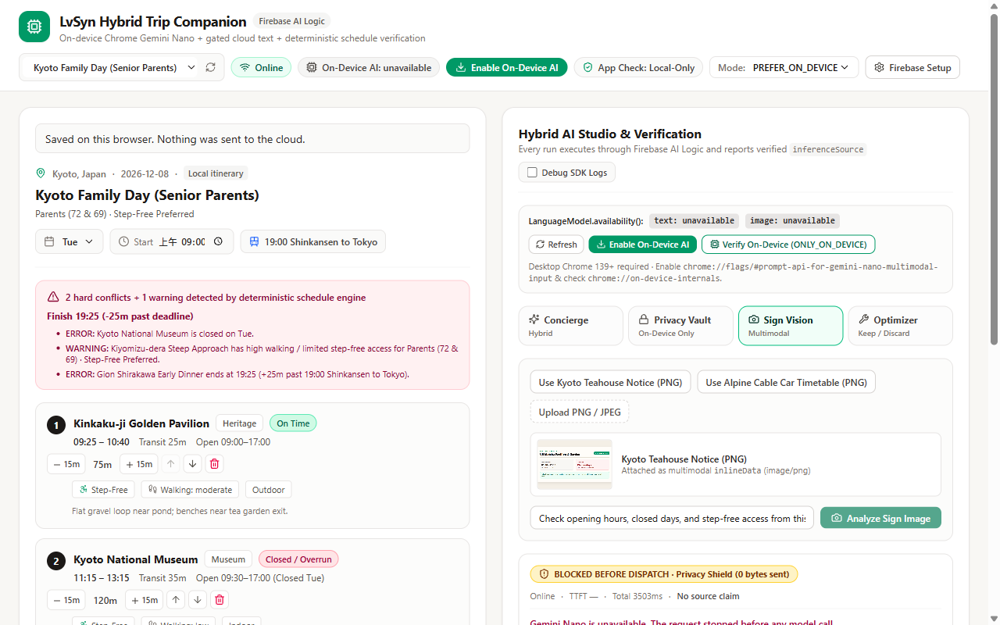
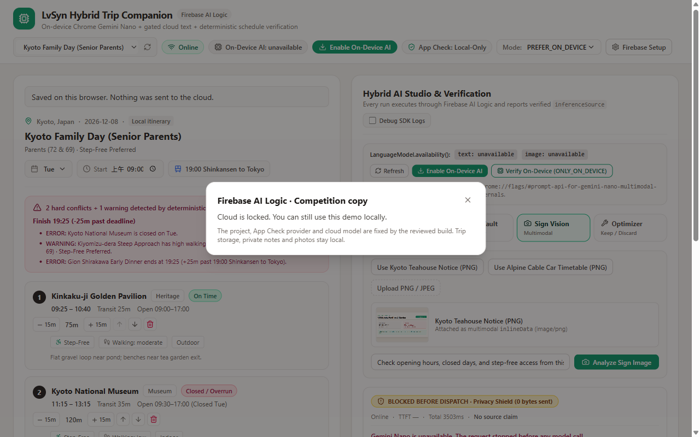

# LvSyn Hybrid Trip Companion

> **Built for Google Firebase `#BuildHybridAI` 2026 (Web / Chrome PWA)**  
> A hybrid AI trip-editing companion for city travelers and families with senior parents—combining **Firebase AI Logic** (`firebase/ai`), **Chrome Gemini Nano**, **Firebase App Check**, and a **deterministic schedule verification engine** inside an offline-capable PWA.

- **Live Hosted Try-It-Out (Web / Chrome PWA):** https://qaqaaa233.github.io/lvsyn-hybrid-trip-companion/
- **Open-Source License:** Apache License, Version 2.0 ([`LICENSE`](LICENSE))

---

## Why Hybrid AI Matters for Multi-Stop Urban Travel

City itineraries—especially trips with older adults, mobility constraints, Tuesday museum closures, and fixed train departures—fail in two distinct ways when handled by cloud-only chatbots:

1. **Privacy & Tunnel Dead-Zones:** Private medical reminders, mobility needs, and accommodation entry codes belong exclusively on the user's device, while rail tunnels and roaming dead-zones frequently drop connectivity mid-day.
2. **Hallucinated Venue Constraints:** Free-form language models regularly overlook weekday closures, cumulative walking burden, and hard return deadlines unless every AI-suggested edit is checked deterministically before saving.

**Unlike single-route trail planners (such as 2025 Chrome Built-in AI winner *Trail*) or cloud-only recommendation feeds (such as 2024 Gemini API winner *Trippy*), LvSyn Hybrid Trip Companion:**
- Runs **all AI inference exclusively through Firebase AI Logic** (`firebase/ai`),
- Enforces **pre-flight local-only guards** closing [`firebase-js-sdk#10635`](https://github.com/firebase/firebase-js-sdk/issues/10635) (`ONLY_ON_DEVICE` silent cloud leak when `LanguageModel` is unavailable) and [`#10690`](https://github.com/firebase/firebase-js-sdk/issues/10690) (multimodal MIME guard),
- Scopes every AI proposal to the active trip (`tripId`) with **deterministic before/after conflict diffs** and explicit **Keep / Discard** confirmation, and
- Exposes **on-device verification controls directly in the UI** (`LanguageModel.availability()` live readout, **Enable On-Device AI**, 1-click **Verify On-Device (`ONLY_ON_DEVICE`)**, and a **Debug SDK Logs** toggle).

---

## Architecture & Hybrid Routing Split



| Feature | Execution Path | Firebase AI Logic Mode | Privacy / Network Guarantee |
|---|---|---|---|
| **On-Device Proof & Concierge** | Chrome Gemini Nano (`en`) first | `PREFER_ON_DEVICE` / `ONLY_ON_DEVICE` | Reports exact `response.inferenceSource` (`on_device` vs `in_cloud`); 0 outbound requests when running on-device |
| **Privacy Vault** | On-device only (`LanguageModel`) | `ONLY_ON_DEVICE` + pre-flight guard | Never transmits to cloud; aborts locally with 0 bytes sent if Chrome Nano is unavailable (`#10635` safeguard) |
| **Multimodal Sign Vision** | On-device image (`image/png`, `image/jpeg`) | `ONLY_ON_DEVICE` / multimodal guard | Verifies image availability independently of text-only capability and rejects unsupported MIME types (`#10690` safeguard) |
| **Deterministic Schedule Engine** | Local TypeScript runtime | Local engine (`src/domain/scheduleEngine.ts`) | Computes opening hours, Tuesday closures, step-free accessibility, and Shinkansen/Express buffers completely offline |
| **Gated Cloud Text Fallback** | `gemini-3.5-flash-lite` + App Check | `ONLY_IN_CLOUD` / `PREFER_IN_CLOUD` (optional Spark binding) | Requires explicit user selection, verified `ReCaptchaEnterpriseProvider` App Check token, and text-only egress validation |

### Verified Firebase AI Logic Entry Points

- **`src/ai/hybridInferenceService.ts`:** Imports `getGenerativeModel`, `InferenceMode`, `InferenceSource` from `firebase/ai` (`@firebase/ai@3.1.0`) and `setLogLevel` from `firebase/app`; invokes `model.initializeDeviceModel(...)` and `model.generateContentStream(...)`; verifies terminal `response.inferenceSource` (`sdk_terminal_response`); enforces text + `en` Chrome Prompt API options, independent multimodal availability checks, and non-PNG/JPEG rejection.
- **`src/firebase/config.ts`, `src/firebase/init.ts`, `src/firebase/req211Egress.ts`, `src/firebase/cloudAttemptBudget.ts`:** Initializes the `GoogleAIBackend()` client, validates Spark-plan Web App configuration via SHA-256 fingerprint, attaches `ReCaptchaEnterpriseProvider` App Check token verification, restricts cloud egress to `gemini-3.5-flash-lite` text prompts, and enforces a client-side daily attempt cap (`DAILY_CLOUD_ATTEMPT_LIMIT = 3` per UTC day).

---

## Screenshots (Built Production Bundle)

| Offline PWA Timeline Edit (`90m -> 75m` persisted offline) | Privacy Vault On-Device Verification (`0 bytes sent`) |
|---|---|
|  |  |

| Multimodal Sign Vision (`inlineData` + local gate) | Firebase Competition Setup Modal |
|---|---|
|  |  |

---

## Pre-Existing App Disclosure (`LvSyn NEXT`)

- **Pre-Existing Work:** Prior to `#BuildHybridAI` 2026, our team created **LvSyn NEXT**, an itinerary planner whose deterministic time-anchoring and **Keep / Discard** co-editing pattern inspired this project. The **LvSyn NEXT** codebase remains private.
- **Built During `#BuildHybridAI` 2026 (This Public Repository):** This repository is a clean-room Apache-2.0 Web/Chrome PWA created specifically for the hackathon, contributing the `firebase/ai` Hybrid Inference layer, Chrome `LanguageModel` readiness & `ONLY_ON_DEVICE` leak guard (`#10635`), independent multimodal image guard (`#10690`), App Check egress validation, subpath-safe Service Worker offline shell, and active-trip-scoped proposal feed.

---

## Judge Verification & Testing Instructions

### Option A: Verify Directly at the Live Hosted URL (Zero Credentials Required)
Open **https://qaqaaa233.github.io/lvsyn-hybrid-trip-companion/** in **Google Chrome Desktop (`>= 139`, recommended `>= 148`)**:

1. **Confirm On-Device Readiness & SDK Proof Controls:**
   - Inside **Hybrid AI Studio & Verification**, check the live `LanguageModel.availability()` readouts (`text` and `image`) and optional **Debug SDK Logs** checkbox (calls Firebase `setLogLevel('debug')`, or toggle via `window.__lvsynSetFirebaseLogLevel(true)` in DevTools Console).
   - If your Chrome shows `downloadable`, click **Enable On-Device AI** to invoke `model.initializeDeviceModel(...)` with live progress, or enable `chrome://flags/#prompt-api-for-gemini-nano-multimodal-input` (`chrome://on-device-internals` shows downloaded weights).
2. **Test `ONLY_ON_DEVICE` & Offline Persistence:**
   - Click **Verify On-Device (`ONLY_ON_DEVICE`)** while DevTools → Network is filtering `generateContent` / `firebasevertexai.googleapis.com`.
   - When Chrome Gemini Nano weights are available on your machine, the card reports `ON-DEVICE · inferenceSource: "on_device"` with **0** outbound requests—even after toggling DevTools **Network → Offline**.
   - Without local Nano weights loaded, Privacy Vault & `ONLY_ON_DEVICE` abort cleanly pre-dispatch with **0 bytes** uploaded.
3. **Verify Deterministic Offline Itinerary Editing:**
   - On **Kyoto Family Day (Senior Parents)**, click **- 15m** on **Kinkaku-ji Golden Pavilion** (`90m -> 75m`) and watch arrival/departure times and the Shinkansen buffer update live.
   - Switch DevTools **Network → Offline**, reload the page, and confirm the offline Service Worker shell loads with your `75m` edit preserved locally.

### Option B: Run Locally & Configure a Free Spark Firebase Project
- **Prerequisites:** Node.js `>= 20` and npm.

```bash
npm install
npm run build
npm test
npm run scan:secrets
```

- **Local Hybrid Inference Contract Tests:** `npm test` runs `8/8` automated tests (`tests/scheduleEngine.test.ts` + `tests/hybridInference.test.ts`), exercising real `@firebase/ai@3.1.0` `getGenerativeModel`, `ChromeAdapterImpl`, `ONLY_ON_DEVICE` leak prevention (`#10635`), unsupported MIME rejection (`#10690`), PNG `inlineData`, and `X-Firebase-AppCheck` headers against `scripts/local-cloud-emulator.mjs`.
- **Optional Live Spark Cloud + App Check Build:** The public repository intentionally bundles zero API keys, `.env.local` files, or App Check debug tokens. To test live cloud text fallback (`gemini-3.5-flash-lite`) with your own no-cost Spark Firebase project, copy `.env.example`, configure a Gemini Developer API project with enforced reCAPTCHA Enterprise App Check, and build with Vite env vars matching `src/firebase/config.ts`.

---

## License

Apache License, Version 2.0 — see [`LICENSE`](LICENSE).
